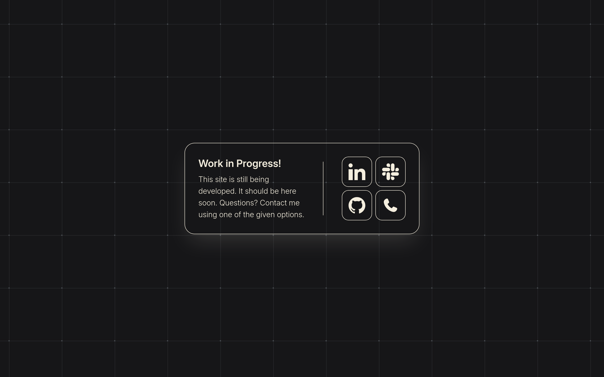

<h1>˖✦ Work in progress ! ˖✦</h1>

<h2>- What is it ? -</h2>
"Work in progress !" (WIP!) is a temporary page which you can put up as a placeholder when you're maintaining or building your website. WIP! is easily customizable if you know a little bit of HTML. To resize stuff you would also need to know how tailwindcss works, or how to read docs. All colours can be customized from `tailwindcss/input.css` via variables. You can also choose icons for the buttons from the 30 pre-installed ones. I'll list them in a spoiler below.  Feel free to use this project yourself, customize to your liking, no need to credit.
 
<h2>- Screenshots ! -</h2>

 

