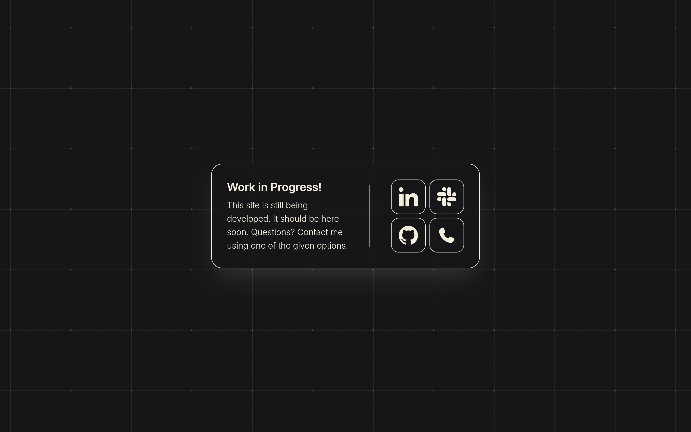
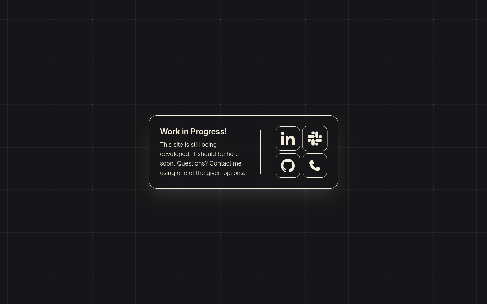

<div align="center">
<h1>˖✦ Work in progress ! ˖✦</h1>
<div>


</div>
<h2>- What is it ? -</h2>
"Work in progress !" (WIP!) is a temporary page which you can put up as a placeholder when you're maintaining or building your website. WIP! is easily customizable if you know a little bit of HTML. To resize stuff you would also need to know how tailwindcss works, or how to read docs. All colours can be customized from `tailwindcss/input.css` via variables. You can also choose icons for the buttons from the 30 pre-installed ones. I'll list them in a spoiler under the setup part. Feel free to use this project yourself, customize to your liking, no need to credit.
<br>
<h2>- Screenshots ! -</h2>
<p>These screenshots may look the same, but take a close look at the slack button. Okay maybe you still don't see it, I get it.. In the second image the Slack button is being 'hovered', so it's a slightly larger scale. Any colour, text, icon and even the size of the boxes in the grid you see in the image are easily configurable. See setup below.</p>



<br>
<h2>- Setup & customizing ! -</h2>
<h3>- Colours -</h3>
<details><summary><i>Click me for details</i></summary>

ㅤ1. **Open `./tailwindcss/input.css` in your editor of choice.** <br>
ㅤ2. **Edit lines 6 to 8:**

```css
6   --color-choco: #161618;     /* This is the background colour */                     ㅤ
7   --color-grid: #5f656a;      /* This is the colour of the lines on the background */ ㅤ
8   --color-oat-milk: #f4eede;  /* This is the white-ish colour */                      ㅤ
```

ㅤ3. **To view your edits open `./index.html` in your browser.** <br> _Note: you might not see the icons load. This is<br> an issue from the browser, appearently it doesn't<br> want to load the icon files when you open the file<br> like this. If you know how, start a https server<br> to see it with the icons._

</details><br>

<h3>- Background -</h3>
<details><summary><i>Click me for details</i></summary>

ㅤ1. **Open `./tailwindcss/input.css` in your editor of choice.** <br>
ㅤ2. **Edit lines 12 & 13:**

```css
12  --sq-sz: 14vh;      /* Square sizes of the grid. Valid formats are px, em, rem, vh, vw and more */   ㅤ
13  --offset: 40%;      /* Offset of the grid. At 0px/0% offset the lines start in the top-left corner */
```

ㅤ3. **To view your edits open `./index.html` in your browser.** <br> _Note: you might not see the icons load. This is<br> an issue from the browser, appearently it doesn't<br> want to load the icon files when you open the file<br> like this. If you know how, start a https server<br> to see it with the icons._

</details><br>

<h3>- Icons & Links -</h3>
<details><summary><i>Click me for details</i></summary>

ㅤ1. **Open `./index.html` in your text/code editor.**<br>
ㅤ2. **The links are on lines 30 to 69.**<br><br>_To change the icon of the top-left link, edit line 35:_

```html
<use href="./assets/sprite.svg#linkedin" /> ㅤ ^^^^^^^^ ㅤ ㅤ Edit this ㅤ
```

<br>

_To change the link of the top-left button, edit line 31:_

```html
<a ㅤ href="./linkedin/"> ^^^^^^^^^^^ ㅤ ㅤ Edit this ㅤ</a>
```

<br>

_Example with link to a YouTube channel:_

```html
<a ㅤ href="https://youtube.com/@yourchannel"> ㅤ</a>
```

<br>

_To open it in a new tab:_

```html
<a ㅤ href="https://youtube.com/@yourchannel" target="_blank" ㅤ> ㅤ</a>
```

`Use this knowledge to change the other icons.`

ㅤ3. **Test the configuration out with a live server. The icons will not load if you simply open `./index.html` in your browser unfortunately.<br>See "Running it locally" on how to start a live-server.**

</details>

<br><h2>- Running it locally ! -</h2>

ㅤ1. **Clone the repo: `git clone https://github.com/git-davidd/workinprogress.git WIP!`**
<br>
ㅤ2. **Change directory into the project directory: `cd WIP!/`**
<br>
3. **Install python: [python.org/downloads/](https://www.python.org/downloads/)**
<br>
4. **Run the live server: `python -m http.server` or `python -m http.server [port]` to also select a port to run the server on.**
<br>
ㅤ5. **Open the website at http://localhost:8000, or http://localhost:[port] if you specified one.**

<br><h2>- License ! - </h2>

This project is licensed under the GNU General Public License v3.0. See the [LICENSE](LICENSE) file for details.

</div>
